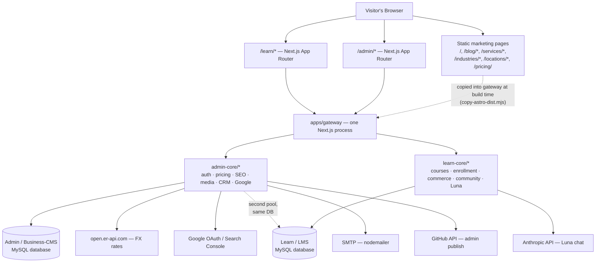
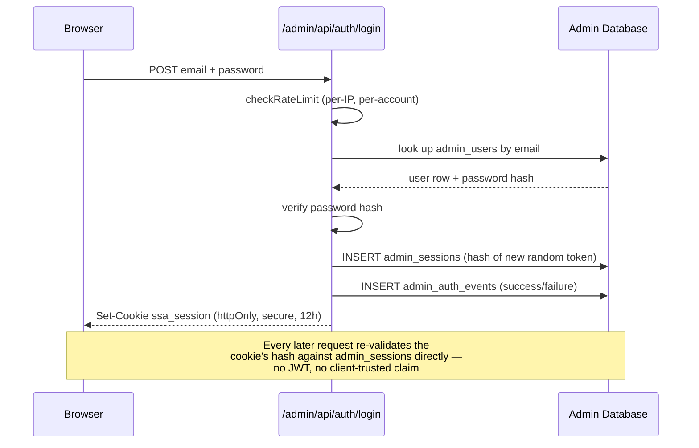
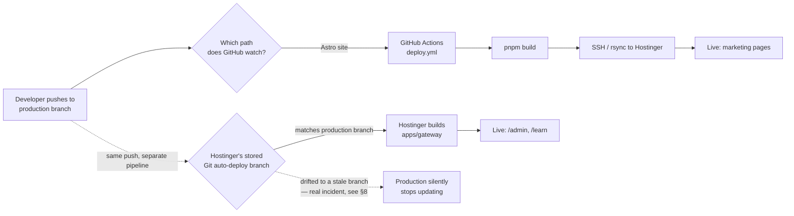
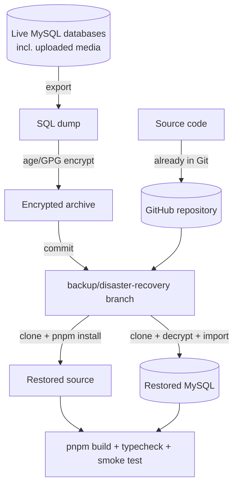

# Shahid Security
## Complete Technical Documentation & System Administration Manual

**Version 1.0 — Prepared 2026-11-16**

This manual is written entirely from the actual, current implementation — verified by reading the real source code, configuration, and database schema, not assumed from a generic template. Every claim is either marked **Verified** (read directly from the code this pass) or **pattern-inferred** (consistent with a confirmed pattern elsewhere, not individually opened). Anything that could not be confirmed is stated as such, not guessed. No secret value — password, API key, token, or connection string — appears anywhere in this document.

---

## Table of Contents

1. [Complete Project Architecture](#1-complete-project-architecture)
2. [Complete Source Code Directory Guide](#2-complete-source-code-directory-guide)
3. [Database Documentation](#3-database-documentation)
4. [Step-by-Step Administration Guide](#4-step-by-step-administration-guide)
5. [Code Access and Modification Manual](#5-code-access-and-modification-manual)
6. [API and Integration Documentation](#6-api-and-integration-documentation)
7. [Backup, Recovery and Restoration Manual](#7-backup-recovery-and-restoration-manual)
8. [Troubleshooting and Maintenance](#8-troubleshooting-and-maintenance)
9. [Security and Maintenance Guidelines](#9-security-and-maintenance-guidelines)
10. [Visual Documentation](#10-visual-documentation)
11. [Environment Variables Reference](#11-environment-variables-reference)
12. [Glossary](#12-glossary)
13. [Backup Restoration Checklist](#13-backup-restoration-checklist)
14. [Revision History](#14-revision-history)

---

## 1. Complete Project Architecture

### 1.1 System overview

Shahid Security is one logical platform under one domain, `shahidiqbal.com`, with no subdomains. It is a monorepo with two halves that deploy through two completely different pipelines:



One process, one Node.js deployment, one domain. "admin-core" and "learn-core" are directory/namespace conventions inside the single gateway app — a holdover from when they were two separate Next.js apps before the platform-consolidation merge. There is no separate admin server or learn server.

### 1.2 Technology stack (verified from `package.json`)

**Root — Astro marketing site** (`/package.json`):
Astro `^7.3.3` · `@astrojs/mdx ^8.0.1` · `@astrojs/sitemap ^3.7.4` · `@astrojs/rss ^4.0.19` · Tailwind CSS `^4.3.3` (CSS-first config, no separate `tailwind.config.js`) · `astro-icon ^1.2.0` · `sharp ^0.35.4` · `zod ^4.5.4` · TypeScript `^5.7.3`.

**`apps/gateway` — merged admin + learn Next.js app** (`apps/gateway/package.json`):
Next.js `16.4.3` · React `19.3.0` · Drizzle ORM `0.45.3` (+ `drizzle-kit 0.31.11`, dev-only) · `mysql2 3.24.4` · `@anthropic-ai/sdk ^0.129.0` (Luna chat) · `@octokit/rest 22.0.1` (admin publish-to-GitHub feature) · `nodemailer 10.3.1` (**not** PHPMailer — PHPMailer was the pre-consolidation Astro-site contact form, now retired) · `zod 4.6.7` · TypeScript `5.7.3`. Dev: `tsx 4.23.15`, `vitest 5.0.2`.

### 1.3 Routing structure

| Path family | Source | Deploy mechanism |
|---|---|---|
| `/`, `/blog/*`, `/services/*`, `/industries/*`, `/locations/*`, `/case-studies/*`, `/pricing/`, `/about/`, `/contact/`, `/book/` | Astro, `src/pages/` + `src/content/` | `.github/workflows/deploy.yml` — GitHub Actions, triggers on push, SSH/rsync to Hostinger |
| `/admin/*` | Next.js App Router, `apps/gateway/src/app/admin/` | **Hostinger's own Git-integration Node.js App pipeline** — not a GitHub Actions workflow |
| `/learn/*` | Next.js App Router, `apps/gateway/src/app/learn/` | Same pipeline as `/admin/*` — same process |

**Trailing-slash handling**: `apps/gateway/src/proxy.ts` (Next 16's renamed convention for `middleware.ts`) reconciles two conventions in one app — Astro pages always use a trailing slash, `/admin/*` and `/learn/*` never do. `next.config.mjs` sets `skipTrailingSlashRedirect: true` so Next's own normalization never runs, and `proxy.ts` does it manually per path prefix with a 308 redirect (method-preserving — a 301/302 would silently downgrade a POST to a GET). This exact mechanism was the root cause of a real production bug where `/admin/` 404'd to the Astro site's own 404 page instead of reaching the gateway — now fixed; see §8.

### 1.4 Authentication and authorization architecture

Two independent, cookie-based, database-validated session systems — not shared, no SSO between them:

- **Admin** (`admin-core/lib/auth/session.ts`): cookie `ssa_session`, `httpOnly`, `secure` in production, `sameSite: lax`. The cookie carries a random 32-byte token; only its SHA-256 hash is stored (`admin_sessions` table) — the raw token never touches the database. Every request re-validates the hash and checks expiry (fixed 12-hour lifetime, no "remember me") and account status. There is no stateless JWT, so revoking a session or suspending a user takes effect immediately.
- **Learn** (`learn-core/lib/auth/session.ts`): same pattern, separate cookie/table, plus its own Google OAuth sign-in path.
- **Role-based access control (admin)**: `admin_users` → `admin_user_roles` ↔ `admin_roles` → `admin_role_permissions` ↔ `admin_permissions` — a genuine permission-matrix RBAC system, not a single `role` string column. One role, `super_admin`, implicitly holds every permission.
- **Defense in depth**: every privileged Server Action calls `requireAdminAction(permissionKey)` (`admin-core/lib/guard.ts`) as its first line, independently re-checking the permission even though the dashboard layout already blocks a signed-out user from rendering the page.
- **Audit trail**: `admin_auth_events` (every login success/failure, logout) and `audit_logs` — insert-only **at the database grant level**, not just by application convention (see §3.1), so it genuinely cannot be altered even by a compromised app process.
- **No public self-registration for admin** — every `admin_users` row is created by an existing Super Admin or the one-time seed script. Learn **does** allow public self-registration.

### 1.5 File and media storage architecture

**Uploaded files are stored as binary blob columns directly in the MySQL database, not on disk.** This is deliberate: a local-disk `UPLOAD_DIR` was tried originally, but Hostinger's actual deploy mechanism replaces the *entire* app directory (not just `.next`) with a fresh versioned copy on every deploy — so anything written to local disk during one deployment is simply gone in the next. This caused a real course-thumbnail-vanishing incident. The fix: file bytes live in the `media` table's `data` column (`LONGBLOB`, up to 4GB) instead, since the database is the one thing the deploy pipeline never touches.

**This has a direct consequence for this manual's §7**: there is no separate "uploads folder" to back up or restore. Media backup and database backup are the same task.

Upload validation: MIME-type allowlist (`image/jpeg`, `image/png`, `image/webp`, `image/gif`, `application/pdf` only — SVG is deliberately excluded, since it can carry embedded script/XSS), 10MB cap, and the stored filename is always `<uuid><allowlisted-extension>` — the browser-supplied filename and MIME type are never trusted, closing the classic "upload shell.php.jpg" bypass class at the source.

### 1.6 Hosting and deployment architecture

Two genuinely separate pipelines for the two halves of one logical site:

1. **Astro marketing site** → `.github/workflows/deploy.yml`. Push-triggered. `pnpm install` → `pnpm build` (`astro check && astro build`) → SSH/rsync deploy → permissions fix. The only automatic, push-triggered deploy in the repo.
2. **`apps/gateway` (`/admin` + `/learn`)** → **not** a GitHub Actions workflow. Deployed through Hostinger's own Git-integration Node.js App feature: a specific branch of this repository is configured in Hostinger's hPanel (or via its API) as the source, with `node_version: 22`, `app_type: next`, `root_directory: apps/gateway`, `output_directory: .next`, `build_script: build`. A webhook rebuilds on every push to whichever branch is configured there.

> **The single most important operational fact in this manual.** A push to the repository's production branch does **not** automatically redeploy `/admin`/`/learn` unless Hostinger's stored Git-auto-deployment branch setting for this Node.js App actually matches that branch. If it drifts — points at an old or abandoned branch — every subsequent push silently stops reaching production for the gateway app while the Astro site keeps deploying normally. This has caused real, hard-to-diagnose incidents on this project: a fix is merged and confirmed correct in the repository, but the live admin/learn site doesn't change, because it's still running a stale branch. **Always confirm the actual deployed commit via Hostinger's own deployment status before trusting that a push reached production.**

A third workflow, `.github/workflows/deploy-gateway.yml`, is deliberately inert — `workflow_dispatch` only, no `push` trigger, no build/deploy steps, only a post-deploy smoke test. It verifies a gateway deploy after the fact; it does not perform one.

---

## 2. Complete Source Code Directory Guide

### Root (Astro marketing site)

| Path | Purpose | Depends on | Breaks if modified incorrectly | Safe to edit directly? |
|---|---|---|---|---|
| `astro.config.mjs` | Integrations, production `site` URL, sitemap `lastmod` logic (reads real frontmatter dates) | `src/content/blog/*`, `src/content/caseStudies/*` frontmatter | Wrong `site` breaks canonical URLs/OG tags site-wide | Yes, with care |
| `src/content.config.ts` | Every content collection's schema (blog, services, caseStudies, industries) via Zod | Every `.mdx` file must match its collection's schema | A new required field fails the build for every file missing it | Yes — add new fields as `.optional()` first |
| `src/pages/` | File-based routing for every public page | `src/components/`, `src/content/`, `src/lib/` | A broken page file fails the whole site build | Yes — normal day-to-day territory |
| `src/components/BaseLayout.astro` | Shared `<head>`, JSON-LD, nav/footer mounts, CSP | Every page | Affects every page at once | Edit carefully; `pnpm build` after |
| `src/lib/site.ts` | Single source of truth for brand facts (founder, tagline, email, address, social) | Referenced across about/contact/footer/JSON-LD | Wrong facts propagate everywhere referenced | Yes — the right place to fix a business fact |
| `src/lib/schema.ts` | JSON-LD helpers (`serviceSchema`, `breadcrumbSchema`, `faqSchema`, `personSchema`) | Every page importing one | A type-valid but semantically wrong object fails Google's Rich Results, not the build | Yes — validate output after |
| `.github/workflows/deploy.yml` | The only automatic push-triggered deploy | GitHub Secrets: `DEPLOY_SSH_KEY_B64`, `DEPLOY_HOST`, `DEPLOY_PORT`, `DEPLOY_USER`, `DEPLOY_PATH` | Stops the Astro site auto-deploying (gateway unaffected) | Edit with care; test via `workflow_dispatch` first |

### `apps/gateway` (merged admin + learn)

| Path | Purpose | Depends on | Breaks if modified incorrectly | Safe to edit directly? |
|---|---|---|---|---|
| `next.config.mjs` | Sets `skipTrailingSlashRedirect: true` | `src/proxy.ts` must handle what Next's default normally would | Removing this without adjusting `proxy.ts` reintroduces the "/admin/ 404s" bug | No — treat as settled |
| `src/proxy.ts` | Next 16's "proxy" (middleware) entry: blocks `/learn/admin/*` (dead duplicate panel), exempts `/admin/*`/`/learn/*` from trailing-slash addition, redirects everything else to add one | `next.config.mjs` | A logic error can silently break routing for an entire prefix (confirmed once in production) | Edit only with full understanding of `EXEMPT_PREFIXES`/`BLOCKED_PREFIXES` — test every case before deploying |
| `src/admin-core/db/schema/*.ts` | Drizzle table definitions: `identity.ts`, `content.ts`, `business.ts`, `crm.ts`, `pricing.ts`, `publishing.ts`, `seo.ts`, `google.ts` | The admin/business-CMS MySQL database | Schema change requires a matching migration (`pnpm db:admin:generate` → `db:admin:migrate`) — editing TS alone changes nothing live | Edit schema, always generate+review+run the migration |
| `src/admin-core/lib/auth/` | `session.ts`, `password.ts`, `tokens.ts`, `rateLimit.ts` | `admin_sessions`, `admin_users`, `rate_limit_hits` | Can lock out every admin user, or fail open | Security-critical — test login/logout/expiry explicitly after any change |
| `src/app/admin/` | Next.js pages for `/admin/*` | `admin-core/*` for logic; pages are thin wrappers | Usually contained to one route | Yes — day-to-day admin work |
| `src/app/learn/` | Same for `/learn/*`, including `learn/admin/` (deliberately blocked — see `proxy.ts` `BLOCKED_PREFIXES`; consolidated into `/admin/dashboard/learn/*` instead) | `learn-core/*` | Same as above | Yes, except don't make `/learn/admin/*` reachable — that was deliberate |
| `scripts/copy-astro-dist.mjs` | Copies the root Astro build output into `apps/gateway/astro-dist/`, served by a catch-all for anything not `/admin` or `/learn` | Root `pnpm build` must have already run | Stale/missing `astro-dist/` serves old marketing pages even if Astro deployed fine separately | Don't edit — build tooling |
| `scripts/flatten-standalone.mjs` | Collapses the pnpm-monorepo nesting in Next's standalone output and fixes `node_modules` symlinks, because Hostinger's deploy only looks at `server.js` and its immediate siblings | Runs after `next build` | Skipping it produces a build that works locally but fails to start once deployed | Don't edit — build tooling |

**Root `package.json` vs. `apps/gateway/package.json` build scripts**: the root `build` = `astro check && astro build` (Astro site only). The gateway's `build` = write build-info → regenerate logos/OG images → **run the root Astro build** → copy its `dist/` → `next build` → flatten. **The gateway's own build script builds the Astro site too** — never call `next build` directly inside `apps/gateway` for a real deploy test; it skips the Astro build/copy step and serves stale marketing pages.

**Not individually verified this pass**: `src/learn-core/db/schema/*.ts` files beyond their names (detail is in §3); the exact call site of the `qrcode` dependency.

---

## 3. Database Documentation

### 3.1 Engine and connection architecture

MySQL via **Drizzle ORM** (`drizzle-orm/mysql2`). **Two real, separate databases**, never a shared schema:

| Database | Owns | Schema location | Connection |
|---|---|---|---|
| Admin / business CMS | admin users, site content, leads/CRM, pricing, Google integrations, SEO | `admin-core/db/schema/` | `admin-core/db/index.ts`, `ADMIN_DATABASE_URL` |
| Learn (LMS) | students, courses, commerce, enrollment, community, support | `learn-core/db/schema/` | `learn-core/db/index.ts`, `LEARN_DATABASE_URL` |

A **third connection, not a third database**, exists: `admin-core/db/learnDb.ts` opens a second pool into the **same** Learn database (so the unified admin dashboard can read/write Learn's data under `/admin/dashboard/learn`), with its own copy of Learn's schema at `admin-core/db/schema/learn/` — a real, manually-kept-in-sync file duplicate, confirmed byte-identical, not a shared import. **Maintenance risk**: if `learn-core`'s schema changes without this copy being updated identically, the admin dashboard's Learn views silently read against a stale shape.

Both connection pools set `connectionLimit: 8` and attach an `on('error', ...)` handler — a deliberate fix for a real incident: an unhandled pool-level error event (a dropped idle connection) otherwise becomes an uncaught exception that kills the entire Node process, not just one request.

**Privilege model**: the app's own runtime database user has **no DDL privileges** (no CREATE/ALTER/DROP). A separate, full-privilege `DATABASE_ADMIN_URL` is required for migrations and for `apply-grants.ts`, which provisions the runtime user's exact table-by-table privileges — notably, `audit_logs` gets `SELECT, INSERT` only, enforced at the database level, so the audit trail cannot be altered or deleted even by a compromised app process. Re-run `apply-grants` after every migration.

### 3.2 Migrations

Drizzle Kit, one config per database (`admin-core/drizzle.config.ts`, `learn-core/drizzle.config.ts`). Generated SQL files, not hand-written: **10 migrations** for admin (`0000_remarkable_hobgoblin.sql` → `0009_good_wither.sql`), **7** for learn.

**Migrations are not automatic** — there is no migration-on-startup code. Each app has its own `db/migrate.ts`, run manually, requiring `DATABASE_ADMIN_URL`.

> **Correction to an earlier assumption in this project's history**: a startup instrumentation hook once bootstrapped pricing-plan data and a super-admin account automatically. The *current* `apps/gateway/src/instrumentation.ts` (the only one Next.js actually loads — near-identical copies in `admin-core/` and `learn-core/` are dead code, left over from before the merge) explicitly removed that bootstrap after confirming it ran successfully once. **Nothing re-seeds automatically on restart today.** A fresh database needs migrations, `apply-grants`, and the relevant seed script(s) run manually — don't assume otherwise.

What the active instrumentation hook does today: sets `__NEXT_PRIVATE_ORIGIN` (fixes a real Server-Action self-fetch failure), force-overrides `LEARN_APP_URL` to `https://shahidiqbal.com/learn` regardless of the stored env value (the stored value likely still points at the retired `learn.shahidiqbal.com` subdomain), and installs `unhandledRejection`/`uncaughtException` handlers that log and recover rather than silently crash-looping — a direct response to a real past incident.

### 3.3 Full table inventory

**Admin / business-CMS database — 48 tables**, grouped:
- **Auth & access (10)**: `admin_users`, `admin_roles`, `admin_permissions`, `admin_role_permissions`, `admin_user_roles`, `admin_sessions` (hash-only), `admin_auth_events`, `rate_limit_hits`, `admin_password_reset_tokens`, `audit_logs`.
- **Site content (5)**: `business_settings` (single-row intended source of truth — not yet wired everywhere per its own comment), `social_profiles`, `services`, `faqs`, `case_studies` (schema comment requires every row be a real, permissioned client engagement).
- **Blog, media & AI (11)**: `blog_authors`, `blog_categories`, `blog_tags`, `blog_posts`, `blog_post_tags`, `blog_post_faqs`, `blog_post_relations`, `media` (**uploaded bytes live here**, `LONGBLOB` column), `ai_knowledge_sources`, `ai_questions`, `ai_conversations`.
- **CRM, leads & payments (9)**: `leads`, `consultations`, `customers`, `review_requests`, `testimonials`, `payment_methods` (tokenized references only), `invoices`, `payments` (no payment provider has confirmed live credentials — see §6), `manual_payment_methods`.
- **Google integrations (5)**: `google_connections` (OAuth tokens AES-256-GCM encrypted at rest), `google_business_profiles`, `google_sync_logs`, `analytics_connections`, `search_console_connections`.
- **Pricing (5)**: `pricing_plans`, `add_on_services`, `consultation_settings`, `fx_rates`, `soc_readiness_settings` (defaults `'disabled'`, never auto-activated).
- **Publishing (1)**: `publications` — tracks real git commits made by the admin "publish" feature (`commitSha`, `previousCommitSha` for rollback, `workflowRunId`).
- **SEO (2)**: `seo_pages` (metadata overrides, keyed by real existing path), `seo_redirects` (data-entry only — **not yet wired to actually serve redirects**).

**Learn (LMS) database — 52 tables**, grouped:
- **Auth & identity (11)**: `users` (a fully separate table from `admin_users`), `roles`, `permissions`, `role_permissions`, `user_roles`, `sessions`, `auth_events`, `email_verification_tokens`, `password_reset_tokens`, `rate_limit_hits`, `oauth_accounts`.
- **Courses (5)**: `instructors`, `courses` (deliberately no price column — see `products`), `course_modules`, `lessons`, `lesson_video_sources`.
- **Commerce (11)**: `products`, `prices` (per currency and per country, integer minor units), `exchange_rates` (admin-set, **never** auto-updated — opposite policy from the admin DB's `fx_rates`), `orders`, `order_items`, `payment_methods`, `payments` (`idempotencyKey` unique, closing a double-charge race), `manual_payment_submissions`, `refunds`, `coupons`, `coupon_usage` (**schema exists, no checkout UI ships yet** per in-schema comment).
- **Enrollment & progress (8)**: `enrollments` (`courseId` uses `onDelete: 'restrict'` so a course can never be accidentally deleted out from under a student's history), `lesson_progress`, `course_progress`, `quizzes`, `quiz_questions`, `quiz_attempts`, `assignments`, `assignment_submissions`.
- **Certificates (2)** — **V2/not-yet-live**: `certificates`, `certificate_verifications`.
- **Community (3)**: `memberships`, `communities` (`url` deliberately never returned by any public API), `community_access`.
- **Platform (3)**: `audit_logs` (same DB-level insert-only protection as admin), `notifications`, `settings` (generic key/value store — the actual mechanism behind "never hardcode a price").
- **Support, training & live classes (9)**: `live_classes`, `live_class_attendance` (**V2/schema-only**), `roadmap_stages`, `resources`, `roadmap_stage_resources`, `announcements`, `support_tickets`, `support_ticket_messages`, `training_requests` (a request to *discuss* Personal Training — never itself a purchase; no price until explicitly agreed and accepted).

### 3.4 How to inspect and safely update records

1. **The admin UI** (`/admin/dashboard/...`) — the intended path for anything a human admin should change. Every write already goes through this app's own validation and, for sensitive actions, the `audit_logs` table.
2. **Direct MySQL access** (phpMyAdmin via Hostinger's hPanel, or any MySQL client with the host's credentials) for anything the admin UI doesn't cover yet. **Never** hand-edit `admin_sessions.session_token_hash`, any `*_token_hash` column, or `google_connections`'s encrypted columns — these are opaque by design. **Never** manually write to `audit_logs` — the grants already prevent this for the app's own user; bypassing that via a privileged connection defeats the point of the audit trail.
3. Treat `media.data` as binary — use the admin media library for anything involving actual file content, not a SQL tool's text view.

### 3.5 Troubleshooting database connection errors

**In production**, both connection files already catch background pool errors and log them (`[db] MySQL pool error...`) rather than crashing — check the application log first. A page that errors once and works on reload is consistent with the documented pool-exhaustion pattern (a page issuing several concurrent queries against a pool sized too small, compounded by the host's own request timeout) — the fix is tuning `connectionLimit`, not guessing at the schema.

**Locally**, a fresh clone has no reachable MySQL by default — any DB-touching route or script fails with `ECONNREFUSED 127.0.0.1:3306` unless `ADMIN_DATABASE_URL`/`LEARN_DATABASE_URL` point at a real, reachable instance (local MySQL, a Docker container, or a tunnel). The Drizzle configs' fallback defaults describe expected **local dev** database names only — never production values.

---

## 4. Step-by-Step Administration Guide

**Permission model** (applies to every module): permissions are database-backed, read fresh on every check — never trusted from a cookie or client claim. `super_admin` implicitly holds every permission. Every privileged Server Action independently re-checks via `requireAdminAction(permissionKey)`.

**Real modules** (`apps/gateway/src/app/admin/dashboard/`) — verified by directory listing, not assumed:

| Module | Path |
|---|---|
| AI | `/admin/dashboard/ai` (`ai/questions`) |
| Business / Services | `/admin/dashboard/business` |
| Configurations | `/admin/dashboard/configurations` |
| Content / Blog | `/admin/dashboard/content` |
| Google integrations | `/admin/dashboard/google` (business-profile, search-console, analytics) |
| Leads | `/admin/dashboard/leads` (+ consultations) |
| Learn (student platform admin) | `/admin/dashboard/learn` — courses, students, enrollments, orders, training-requests, communities, payment-methods, exchange-rates, announcements, payments, roadmap |
| Media | `/admin/dashboard/media` |
| Payments | `/admin/dashboard/payments` (+ methods) |
| Pricing | `/admin/dashboard/pricing` (plans, add-ons) |
| SEO | `/admin/dashboard/seo` (redirects, health, pages) |
| Testimonials | `/admin/dashboard/testimonials` (+ review-requests) |
| Users | `/admin/dashboard/users` |

**Stated plainly where this differs from a typical admin panel:**
- **No dedicated audit-log viewer exists.** `logAudit()` genuinely writes to `audit_logs` on every sensitive action, but no admin page reads it back yet — reviewing it today requires a direct database query.
- **SEO "redirects" is data-entry only** — not yet wired to actually serve redirects in production.
- **No separate "invoices" module** — Payments is the closest equivalent.
- **No CMS-style page editor** — the marketing site is static Astro source; only the Blog module is genuinely admin-editable content.

### Module walkthroughs

**Users** (`/admin/dashboard/users`) — list → "New" to create a staff account, or open `users/[id]` to edit role assignments / deactivate. A role change takes effect on the user's *next* permission check, not their current session's cookie.

**Pricing** (`/admin/dashboard/pricing`) — Plans tab: edit price/features/status per tier. Add-ons tab: one-off services with starting price. **A price change is not instant on the public `/pricing/` page** — the base USD figures are baked in at the next Astro rebuild, though the client-side currency widget reads live data.

**Business / Services** (`/admin/dashboard/business/services`) — manages the service catalogue *records*, distinct from the static Astro `/services/*` marketing pages.

**Content / Blog** (`/admin/dashboard/content/blog`) — the one genuinely CMS-like module. **Verify which source the public `/blog/` pages actually read from** (this database table vs. the Astro `src/content/blog/*.mdx` files) before relying on a specific publish behavior.

**Leads** (`/admin/dashboard/leads`) — contact-form and consultation-booking submissions; "contact inquiries" and "booking management" are the same module here, not separate.

**Learn** (`/admin/dashboard/learn/*`) — the largest module: courses, students, enrollments, orders, training requests (personal training specifically), communities, announcements, payment methods, exchange rates, payments, roadmap.

**Media** (`/admin/dashboard/media`) — manages uploaded media. **Files live in the database, not on disk** (§1.5) — any "where are my files" troubleshooting starts there.

**Google** (`/admin/dashboard/google/*`) — Business Profile, Search Console, Analytics connection UI. See §6 for the redirect-URI gotcha this project has already hit once.

**General troubleshooting pattern**: every Server Action throws a specific `ForbiddenError`/`UnauthenticatedError` on a permission/session failure — if "nothing happens when I click Save" is reported, confirm the user's actual role/permission first, not a form bug.

---

## 5. Code Access and Modification Manual

### Project shape
A **pnpm workspace** (`pnpm-workspace.yaml`): packages are `.` (root Astro site) and `apps/*` (just `apps/gateway`). Two routing conventions coexist: the Astro site uses file-based routing under `src/pages/`; `apps/gateway` uses Next.js App Router under `src/app/` (`page.tsx` = route, `route.ts` = API endpoint, `layout.tsx` = wraps a subtree).

`pnpm-workspace.yaml` carries two load-bearing settings: `allowBuilds: { esbuild: true }` (pnpm v11's key to allow a dependency's postinstall build script — the older `onlyBuiltDependencies` key is silently ignored by v11 and previously broke a real Hostinger build) and an `overrides` pin collapsing three vulnerable transitive `esbuild` copies into one patched version.

### Opening the project
Open the repository root in any editor — one workspace covers both the Astro site and `apps/gateway`.

### Finding the code behind a page — worked examples

1. **A static marketing page**: `/pricing/` → `src/pages/pricing.astro`, which does a build-time `fetch()` to `admin/api/public/pricing-plans` (that route reads `admin-core/lib/pricing/plans.ts` → the `pricingPlans` table) plus a client-side fetch for live currency conversion.
2. **An admin module**: `/admin/dashboard/pricing/plans` → `page.tsx` (UI) + co-located `actions.ts` (Server Actions). The action calls `requireAdminAction()` then **the same** `admin-core/lib/pricing/plans.ts` module the public API reads — a change there affects both the admin UI and the public API.
3. **A student-facing feature**: `/learn/dashboard/personal-training` (student request form) pairs with `/admin/dashboard/learn/training-requests` (admin side), reading/writing the same table from opposite directions.

**General rule**: start at the `page.tsx`/`.astro` file → find its `actions.ts`/`route.ts` (or `fetch()` target) → follow into `admin-core/lib/*` or `learn-core/lib/*`, which is where the real Drizzle query lives.

### Modifying things
- **Marketing text/layout**: edit the `.astro` file or component directly. Blog content is MDX frontmatter + body in `src/content/blog/*.mdx`.
- **Styling**: global tokens in `src/styles/global.css` (Tailwind v4 is CSS-first); component-scoped styles live in each `.astro` file's `<style>` block.
- **Admin/Learn UI**: edit the relevant `page.tsx` under `app/admin/dashboard/**` or `app/learn/dashboard/**`.
- **New marketing page**: a new `.astro` file under `src/pages/` — no registration step.
- **New admin/learn page**: a new directory with a `page.tsx` under the matching `dashboard/` tree — no registration step.
- **New API endpoint**: a `route.ts` exporting `GET`/`POST`/etc. under `app/**/api/**`. Public endpoints live under an `api/public/` segment by this project's own convention — follow it.
- **Database models/migrations**:
  ```bash
  pnpm db:admin:generate   # or db:learn:generate
  pnpm db:admin:migrate
  pnpm db:admin:apply-grants   # real, separate step — sets DB-level privilege grants
  ```

### Installing, running, building, testing
```bash
pnpm install                     # whole workspace, one pass

pnpm dev                         # Astro site, repo root
cd apps/gateway && pnpm dev      # gateway — copies Astro's last build first, then `next dev -p 3100`
                                  # (not a live reflection of Astro source edits — rebuild Astro to pick those up)

pnpm build                       # Astro: astro check && astro build (fails outright on error)
cd apps/gateway && pnpm build    # gateway: rebuilds Astro internally too — don't call `next build` directly

cd apps/gateway && pnpm test:admin   # or test:learn — BOTH require a reachable MySQL database
```

### Reviewing before deploy
`pnpm astro check` (root) · `pnpm typecheck` + `pnpm lint` (gateway) · a full `pnpm build` in both locations as the final gate.

### A real, documented development error
`pnpm install` on a fresh clone can abort with `ERR_PNPM_IGNORED_BUILDS` if the installed pnpm major version doesn't recognize `pnpm-workspace.yaml`'s `allowBuilds` key. **Confirm the pnpm version in use matches what this config expects before changing the config** — changing the key to an older pnpm's expectation is exactly what broke a real production build previously (commit `c4666f7`).

---

## 6. API and Integration Documentation

### Two confirmed route patterns
1. **Public/rate-limited** (login, Luna chat, contact, booking): Zod-validated body, per-IP (sometimes per-account) rate limiting via `checkRateLimit()`, graceful degradation on optional side effects (email sending never blocks a successful DB write).
2. **Secret-gated internal** (every route under `/api/internal/*`): checks a custom header against an environment variable, returns 403 on mismatch — used for operator-only actions on a host with no interactive shell.

### Admin API (`apps/gateway/src/app/admin/api/`)

| Route | Method | Purpose | Auth |
|---|---|---|---|
| `/admin/api/auth/login` | POST | Login, creates session, logs `admin_auth_events` | Public, rate-limited (20/15min IP, 8/15min account) |
| `/admin/api/auth/logout` | POST | Destroys session | Session required |
| `/admin/api/auth/request-password-reset`, `/reset-password` | POST | Password reset flow | Public, rate-limited / token-gated |
| `/admin/api/google/callback`, `/connect/[scope]` | GET | Google OAuth flow for integrations | Session required |
| `/admin/api/internal/*` (apply-grants, migrate, seed-super-admin, seed-pricing-data, refresh-fx-rates, publish-scheduled, import-legacy-blog-posts, set-consultation-fee, set-password) | POST | Operator-only maintenance actions | Secret-gated (see §11) |
| `/admin/api/media/[id]` | GET | Serves a stored media blob by ID | Public (images render in `` tags) |
| `/admin/api/public/pricing-plans` | GET | Pricing catalogue, optional `?currency=` conversion | Public, CORS-open, rate-limited (120/15min IP) |
| `/admin/api/public/geo-currency`, `consultation-booking`, `leads-intake`, `ai-questions-intake` | GET/POST | Public-facing intake/detection endpoints | Public, rate-limited |
| `/api/contact.php` *(deliberately preserves the legacy URL, at the app root)* | POST | Contact form → `leads` table + best-effort email; honeypot + minimum-time-to-submit + rate limit | Public, rate-limited |
| `/api/report-download.php`, `/api/report-file.php` | — | Gated report-download feature (e.g. case-study PDF) | Not individually re-verified this pass |

> **A real, documented past bug**: `/api/contact.php`'s own code comment confirms the contact form was **silently returning 405 on every submission** for a period after the platform-consolidation merge — the old static `.php` file was being served as a GET-only static asset with no POST handler. This `route.ts` fixed it by taking precedence over the catch-all for that exact path.

### Learn API (`apps/gateway/src/app/learn/api/`)

| Route | Method | Purpose | Auth |
|---|---|---|---|
| `/learn/api/auth/{login,logout,register,request-password-reset,reset-password,verify-email}` | POST | Student account auth (register exists here, unlike admin) | Public, rate-limited (except logout) |
| `/learn/api/auth/google`, `/google/callback` | GET | Student Google sign-in (separate from admin's Google *integration* OAuth) | Public |
| `/learn/api/internal/{apply-grants,migrate,seed-admin}` | POST | Same secret-gated pattern, scoped to the learn schema | Secret-gated |
| `/learn/api/luna/chat` | POST | Luna AI chat — local FAQ fast-path first, falls through to the Anthropic API | Public, CORS-open, rate-limited (30/15min IP) |
| `/learn/api/public/{courses,pricing,roadmap}` | GET | Public catalogue/pricing/roadmap reads | Public |

### Third-party integrations

**Google (OAuth sign-in + Search Console/Analytics/Business Profile)** — two separate OAuth applications (admin staff vs. learn students). Verify via `/admin/dashboard/google`'s connected/disconnected state with a recent sync timestamp. A redirect-URI mismatch error means the configured redirect doesn't exactly match what's registered in Google Cloud Console (protocol, trailing slash, host) — this project has hit exactly this bug once already (commit `af1aa12`, Learn registration).

**FX rate service (open.er-api.com)** — converts USD prices to a visitor's local currency for *display only*, never the actual charge. Free, keyless, no SLA. Verify via `GET /api/public/pricing-plans?currency=AED` — `usedFallback: true` means no cached rate yet (falls back to USD), not necessarily broken. Recommended refresh cadence ~6 hours via an external cron hitting the secret-gated refresh endpoint — confirm this cron actually exists in hPanel, since nothing in the code self-schedules it.

**Cloudflare Turnstile** — bot protection on the contact form. If the public site key is empty, both the widget and server-side check intentionally skip (a documented fallback, not a bug) — but means no bot protection until set.

**SMTP / email** — **two unrelated paths**: the Astro contact form uses PHPMailer with a config file outside the repo (`php/config-template/`); the gateway has its own separate `SMTP_*` variables for whatever mail it sends directly. A failure in one says nothing about the other.

**Anthropic (Claude) — Luna chat** — powers the AI chat beyond the local FAQ fast-path; the route explicitly checks for the API key and the FAQ fast-path still works with none set. A past "could not reach" error was traced to a network/response-parsing issue, not the key itself — check the actual error before assuming a credentials problem.

**GitHub (admin "publish" integration)** — a real, non-obvious one: the admin dashboard's content/SEO publish actions commit changes back to this same repository programmatically via `@octokit/rest`. The token used has write access to the project's source — treat it with deploy-credential-level care.

**Not confirmed active**: `PAYMENT_PROVIDER`/`PAYMENT_API_KEY`/`PAYMENT_SECRET` and `EMAIL_PROVIDER_API_KEY` were found by variable name but no live call site was traced — the Learn checkout flow uses a manual-payment-pending pattern (an admin manually confirms payment), not an automated gateway charge, as far as this pass could confirm. Do not describe a payment gateway as operational without verifying this directly first.

---

## 7. Backup, Recovery and Restoration Manual

### 7.1 Where the backup lives
A dedicated branch of this same GitHub repository, `backup/disaster-recovery-2026-11-16` (not the production branch — this keeps disaster-recovery material clearly separated without disturbing the live `claude/wizardly-keller-yg0bj7` branch or its deploy pipelines). It contains: the full source code (same as production, since source already lives in Git), this manual, a `documentation/` suite, a snapshot of the database **schema** (not data) under `database/schema/`, and — once provided — an **encrypted** archive of actual database contents under `database/encrypted-backups/`.

### 7.2 How the encrypted backup is organized
See `SECURITY_AND_ENCRYPTION_GUIDE.md` in the backup branch for the authoritative, current instructions. In outline: database content (which, per §1.5, includes all uploaded media bytes) is exported, then encrypted with a passphrase-based tool (age or GPG) before ever being committed — the encryption passphrase itself is **never** stored in this repository, in this manual, or in any committed file.

### 7.3 Restoring source code
```bash
git clone https://github.com/cybertingle-rgb/shahidsecurity.git
cd shahidsecurity
git checkout <production-branch>     # or the backup branch, to recover documentation/schema too
pnpm install
```

### 7.4 Restoring the database
1. Stand up a MySQL instance (local, Docker, or a new hosting account).
2. Decrypt the backup archive (see `SECURITY_AND_ENCRYPTION_GUIDE.md` for the exact command — requires the passphrase, which is never in this repository).
3. Create the two databases (admin/business-CMS and learn/LMS — see §3.1) and import the decrypted SQL.
4. Set `ADMIN_DATABASE_URL`, `LEARN_DATABASE_URL`, and `DATABASE_ADMIN_URL` to point at the restored instance.
5. Run `pnpm db:admin:apply-grants` and the learn equivalent, to re-establish the narrow runtime-user privileges (including the audit-log insert-only protection) — a raw SQL import does not recreate these grants by itself.

### 7.5 Restoring uploaded files and media
**There is no separate step.** Per §1.5, uploaded file bytes are inside the database's `media` table, not on a filesystem — restoring the database in §7.4 restores every uploaded file along with it.

### 7.6 Restoring environment configuration
Never stored as plaintext anywhere in this repository. `documentation/ENVIRONMENT_VARIABLES_REFERENCE.md` lists every variable name and what it's for; real values must be re-obtained from their original source (Google Cloud Console, Cloudflare dashboard, a newly generated random secret, etc. — see that document's own "where to get a value" column) and entered directly into the new environment's variable store. Never paste a real secret into a chat, a commit, or this manual while doing this.

### 7.7 Verifying a successful restoration
- `pnpm astro check && pnpm build` (root) and `pnpm typecheck && pnpm build` (`apps/gateway`) both complete with no new errors.
- The restored app starts and `/`, `/admin`, `/learn` all respond.
- Logging in as a restored admin account succeeds, and the dashboard shows real restored data (a known lead, a known blog post, a known pricing plan).
- Table counts in the restored database roughly match the counts in this manual's §3.3 (exact counts will differ over time as the business operates — the *structure*, 48 + 52 tables across two databases, should not).

### 7.8 Recovering on a new machine or hosting environment
Follow §7.3–§7.7 in order on the new environment, then separately re-establish the two deployment pipelines (§1.6): point a GitHub Actions secret set at the new host for the Astro site, and configure a new Hostinger (or equivalent) Node.js App's Git auto-deployment for `apps/gateway`, pointed at the correct production branch — and **actively verify** that setting rather than assuming it, given this project's own history of that setting silently drifting.

---

## 8. Troubleshooting and Maintenance

Each entry is grounded either in a real bug this project has actually hit (commit cited) or in how the relevant system is actually built (file cited) — none are generic boilerplate.

| Symptom | Real precedent / grounding | Diagnostic steps | Safe fix |
|---|---|---|---|
| A path works at its canonical form but 404s (or shows the *wrong* site's 404) with/without a trailing slash | Commit `9d920e5` — `/admin/`, `/learn/` fell through to the Astro site's own 404 | Check `proxy.ts`'s `EXEMPT_PREFIXES` handling for the path; confirm whether it matches a real route exactly | Redirect (308, method-preserving) the trailing-slash variant to canonical, don't pass it through unchanged |
| A link/``/`fetch()` resolves to the wrong path after a routing-structure change | Commits `dd646ba`, `24f6e3c`, `0f1323b`, `55a795a`, `c83d929` — un-prefixed calls broke login/navigation during the basePath consolidation | Search for raw string-literal URLs instead of a prefix-aware helper | Route all internal links/fetches through a shared helper that knows the current prefix convention |
| A fix is clearly pushed and merged, but production still behaves like the old version | A real incident: Hostinger's gateway Git auto-deploy was pointed at a stale, abandoned branch | Check the actual deployed commit/branch via Hostinger's deployment status, compare to the repo's production HEAD | Correct the stored auto-deploy branch (fixes future pushes too), then trigger a fresh build — don't wait for the next push |
| High Total Blocking Time / poor INP on a page that doesn't look heavy | Commit `3d4dc7a` — `CursorParticles.astro`'s animation loop ran forever from page load regardless of whether anything was ever drawn | Look at Lighthouse's long-task attribution, not just the score; check shared/root-layout components for logic that runs continuously | Lazy-start/stop any continuous loop; skip setup entirely for device classes where a feature can't apply |
| A Google integration connect/callback fails or errors out | Commit `af1aa12` — a real `redirect_uri` mismatch in Learn registration | Check the configured redirect URI against exactly what's registered in Google Cloud Console (protocol, slash, host) | Fix the mismatch — this is almost never a credentials problem when it fails specifically at the redirect step |
| A staff member is unexpectedly signed out | Grounded in `session.ts`: fixed 12-hour sessions, no "remember me" | Confirm genuine expiry vs. a cookie-delivery issue (`secure` flag mismatch between `NODE_ENV` and actual protocol) | Verify HTTPS is actually in effect wherever `NODE_ENV=production` is set |
| An uploaded file/image appears missing | Grounded in `media.ts`: files live in the database, never on disk | Check the `media` table record first | A filesystem-based fix will never find anything — nothing is ever written there by design |
| A build fails, locally or on the host | — | Run the exact failing step locally first (`pnpm astro check`/`build`, then gateway `typecheck`/`build`) before assuming a hosting issue | The gateway build chains the Astro build internally — a "gateway build failure" is often an Astro-side error surfacing partway through |
| A payment or checkout issue is reported | Not independently traced this pass | Start from `admin/dashboard/payments` and `learn/dashboard/checkout` and confirm the actual flow before assuming a gateway-integration cause | See §6 — no payment provider was confirmed live; the actual mechanism may be manual-confirmation, not an automated charge |

---

## 9. Security and Maintenance Guidelines

**Secrets stay out of Git.** `.gitignore` excludes `.env`/`.env.local`/`node_modules/`/`dist/`/`.next/` plus PHP-specific secret paths. No `.env` file is committed. Real secrets live only in the production host's own environment-variable store (masked on read, cannot be read back even through the hosting API) and, for the legacy PHP contact path specifically, a config file deployed outside `public_html`. One of the two `.env.example` files is currently stale (documents a pre-consolidation subdomain pattern no longer used) — flagged for cleanup, not yet fixed.

**Admin session security.** Database-backed, not JWT (§1.4) — a leaked database row alone doesn't hand over a usable session (the stored value is a one-way hash); a leaked cookie does, same as any session system. Login is rate-limited by a simple DB-backed counter, intentionally sized for "a handful of staff accounts" — not designed to withstand large-scale credential stuffing; revisit (IP-based limits, Redis) if the admin user base or its exposure grows.

**File upload security** (`media.ts`): 10MB cap, strict MIME allowlist (no SVG — XSS risk), stored filename always `<uuid><allowlisted-extension>`, never the browser-supplied name or MIME claim.

**Input validation**: Zod schemas are the established pattern across admin/learn API routes (confirmed: 15+ files import from `zod`) — new routes should follow this, not ad hoc manual checks.

**Dependency updates**: Dependabot is configured for `npm`, `composer`, and `github-actions`, weekly, capped at 10 open PRs per ecosystem — updates already arrive as reviewable PRs without extra setup; the task is reviewing and merging them.

**Backup frequency recommendation**, given this project's actual deployment pattern (single production environment, uploaded files inside the database): a **daily** automated database export is the realistic minimum once a working export mechanism exists; weekly is a bare minimum, not a target. Recovery testing should happen on its own schedule — a quarterly "restore into a clean environment and verify it boots" drill is reasonable for a project this size. No defined credential-rotation schedule was found for any secret in §11 — recommend rotating session secrets and any broadly-scoped API key (notably the GitHub token, which can write to the source repo) on a defined schedule or immediately on suspected exposure.

**Known, unresolved technical debt, stated plainly**: `admin/api/auth/login/route.ts` still contains temporary diagnostic `console.log` lines left in from a past production-hang investigation ("...remove once the hang is root-caused and fixed," per its own comment) — not a security risk by itself, but worth cleaning up, and worth knowing about if that route's log output looks unexpectedly verbose.

---

## 10. Visual Documentation

### Authentication flow (admin)



### Deployment workflow



### Backup and restoration flow



---

## 11. Environment Variables Reference

Verified by grepping real `process.env.*`/`import.meta.env.*` usage. No value below is a real secret.

| Category | Variables | Required? |
|---|---|---|
| **Database** | `DATABASE_URL`, `ADMIN_DATABASE_URL`, `LEARN_DATABASE_URL`, `DATABASE_ADMIN_URL`, `DATABASE_APP_HOST` | Required (production); `TEST_DATABASE_URL` + 3 `TEST_*` variants required only to run the vitest suites, must point at a disposable DB, never production |
| **Auth / sessions** | `ADMIN_SESSION_SECRET`, `LEARN_SESSION_SECRET`, `ADMIN_SEED_EMAIL`, `ADMIN_SEED_PASSWORD`, `TOKEN_ENCRYPTION_KEY` | Required |
| **Google** | `ADMIN_GOOGLE_CLIENT_ID`/`_SECRET`/`_REDIRECT_URI`, `LEARN_GOOGLE_CLIENT_ID`/`_SECRET`, `GOOGLE_ANALYTICS_PROPERTY_ID` | Required only where that specific Google feature is used |
| **Email / SMTP** | `SMTP_HOST`/`_PORT`/`_USER`/`_PASSWORD`/`_FROM_EMAIL`/`_FROM_NAME`, `EMAIL_FROM`, `EMAIL_PROVIDER_API_KEY` | Required for gateway-sent mail; the Astro contact form uses a separate PHP config, not these |
| **Payments** | `PAYMENT_PROVIDER`, `PAYMENT_API_KEY`, `PAYMENT_SECRET` | **Not confirmed active** — found by name, no live call site traced; confirm before treating as operational |
| **Anti-spam** | `TURNSTILE_SECRET_KEY`, `PUBLIC_TURNSTILE_SITE_KEY` | Required where Turnstile-protected forms exist; empty site key = both checks intentionally skip |
| **Internal maintenance routes** | `SEED_SECRET`, `MIGRATE_SECRET`, `FX_REFRESH_SECRET`, `PUBLISH_SCHEDULED_SECRET`, `LEADS_INTAKE_SECRET`, `AI_QUESTIONS_INTAKE_SECRET` | Each gates one `/api/internal/*` route — long random strings, production-only, never reused |
| **Platform / build** | `NODE_ENV`, `NEXT_PUBLIC_APP_URL`, `ANTHROPIC_API_KEY`, `GITHUB_TOKEN`/`_REPO_OWNER`/`_REPO_NAME`/`_REPO_BRANCH` | Required as noted; `GITHUB_TOKEN` has write access to this repository's source — treat as a deploy credential |

**Known stale file**: `apps/gateway/.env.example` still documents `ADMIN_APP_URL`/`LEARN_APP_URL` pointing at the retired subdomain architecture — confirmed unreferenced anywhere in current code. Needs updating or removal (not fixed as part of writing this manual, flagged here instead).

---

## 12. Glossary

| Term | Meaning in this project |
|---|---|
| **Gateway** | `apps/gateway` — the single Next.js app serving both `/admin/*` and `/learn/*`, the result of merging the formerly-separate `apps/admin` and `apps/learn` apps |
| **admin-core / learn-core** | Directory namespaces inside `apps/gateway` for each half's business logic — not separate apps or servers |
| **Proxy** (Next.js) | Next 16's renamed convention for what used to be `middleware.ts` — `apps/gateway/src/proxy.ts` |
| **Server Action** | A Next.js function that runs on the server, invoked directly from a form/UI without a hand-written API route — used throughout the admin/learn dashboards |
| **RBAC** | Role-Based Access Control — the real, database-backed permission-matrix system behind admin access (§1.4) |
| **Drizzle** | The TypeScript ORM used for all database access (`drizzle-orm`), paired with `drizzle-kit` for migrations |
| **LONGBLOB** | A MySQL column type holding up to 4GB of binary data — how every uploaded file's bytes are actually stored |
| **Secret-gated internal route** | A `/api/internal/*` endpoint that checks a header against an environment-variable secret instead of a user session — for operator actions on a host with no shell access |
| **V2 / schema-only** | A database table that exists and is migrated, but has no corresponding working feature/UI yet (coupons, certificates, live classes, as of this manual's writing) |

---

## 13. Backup Restoration Checklist

- [ ] Clone the repository and check out the production branch (or the backup branch, for documentation/schema).
- [ ] `pnpm install` at the repo root.
- [ ] Stand up a MySQL instance for the restored environment.
- [ ] Decrypt the database backup archive (passphrase obtained separately, never from this repo).
- [ ] Create both databases and import the decrypted SQL.
- [ ] Set all required environment variables (§11) to real values obtained from their original sources.
- [ ] Run `apply-grants` for both databases.
- [ ] `pnpm build` (root) and `pnpm build` (gateway) both succeed with no new errors.
- [ ] `/`, `/admin`, `/learn` all respond on the restored environment.
- [ ] Log in as a restored admin account and confirm real data appears (a known lead, post, pricing plan).
- [ ] Table counts roughly match §3.3 (48 + 52 across two databases).
- [ ] Re-establish both deployment pipelines (GitHub Actions secrets; Hostinger or equivalent Git auto-deploy, branch **actively verified**, not assumed).
- [ ] Document anything that did not restore cleanly, rather than declaring success regardless.

---

## 14. Revision History

| Version | Date | Notes |
|---|---|---|
| 1.0 | 2026-11-16 | Initial complete manual, written and verified against the live repository as part of the Shahid Security disaster-recovery backup project. |
